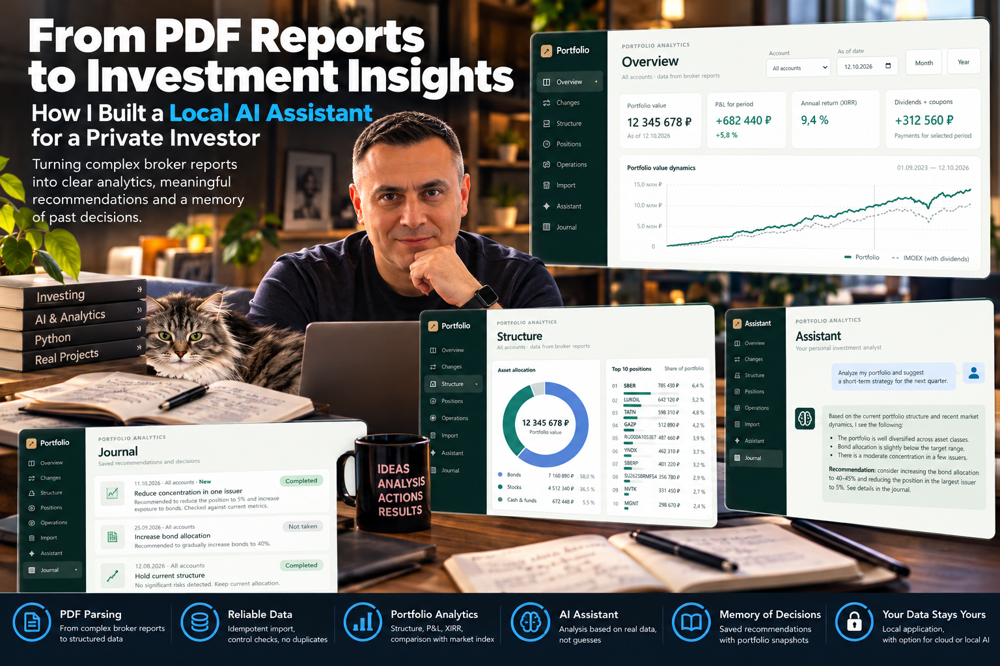

# Я создал AI-ассистента для частного инвестора. И понял, почему нейросеть - не самая сложная часть

**Andrey Semenov**
*Hypermarket Director | Operational Excellence | AI Business Transformation*

Последние две недели я практически выпал из публичного пространства.

Не потому, что перестал заниматься искусственным интеллектом. Наоборот - я погрузился в разработку нового продукта для частного инвестора.

Задача звучала достаточно просто: создать персональную систему, которая собирает данные из брокерских отчётов, анализирует инвестиционный портфель и помогает принимать решения с использованием AI.

Казалось бы, что сложного? Подключить нейросеть, загрузить отчёты, построить несколько графиков.

Но на практике всё оказалось гораздо интереснее.

Главная сложность была не в том, чтобы научить AI отвечать на вопросы. А в том, чтобы создать систему, цифрам и выводам которой можно доверять.

И вот несколько архитектурных решений, которые я реализовал в этом проекте.

## 1. Превратить брокерские PDF в структурированные данные

Всё начинается с брокерского отчёта.

Для человека это привычный документ. Для программной системы - набор таблиц с операциями, датами, комиссиями, выплатами и остатками.

Причём одни и те же финансовые события могут отражаться в разных разделах.

Я разработал механизм обработки PDF-отчётов ВТБ, который извлекает и нормализует информацию о сделках, позициях и денежных движениях.

Но здесь возникла важная инженерная задача.

Что произойдёт, если пользователь случайно загрузит один и тот же отчёт дважды?

Без защиты система может задвоить операции. А значит, неправильно рассчитать позиции, денежные потоки и доходность.

Поэтому я предусмотрел идемпотентный импорт: повторная обработка уже учтённых данных не должна создавать дубликаты.

Для финансовых расчётов использовал Decimal - чтобы не допускать типичных ошибок представления десятичных чисел.

**Вывод: прежде чем добавлять искусственный интеллект, нужно обеспечить качество исходных данных.**

## 2. Не все цифры можно рассчитать. И это нормально

Следующая задача - построить полноценную аналитику портфеля.

Стоимость активов, структура вложений, доходы от купонов и дивидендов, P&L, XIRR, историческая динамика.

Для получения рыночных данных я реализовал интеграцию с Московской биржей через MOEX ISS.

Система сопоставляет инструменты, загружает исторические котировки и использует их в расчётах.

Отдельно реализовано сравнение динамики портфеля с индексом IMOEX с учётом денежных пополнений в сравнительном сценарии.

И здесь я столкнулся с проблемой, знакомой любому аналитику.

Что делать, если история данных неполная?

Например, часть операций отсутствует или невозможно достоверно восстановить первоначальную стоимость позиции.

Можно попытаться получить красивый показатель любой ценой.

А можно честно сообщить пользователю: данных недостаточно.

Я выбрал второй подход.

Если показатель нельзя корректно рассчитать, приложение показывает ограничение вместо вымышленного результата.

Иногда, например, на одном из экранов стоимость портфеля и XIRR доступны, а P&L за выбранный период отображается как «н/д» и с объяснением причины.

Для меня это один из важнейших принципов финансовой аналитики:

**Лучше показать отсутствие достоверного расчёта, чем убедительно продемонстрировать неправильный.**

## 3. AI не должен самостоятельно придумывать финансовые показатели

Когда расчётная часть заработала, я перешёл к AI-ассистенту.

И здесь принял принципиальное архитектурное решение.

Нейросеть не должна самостоятельно вычислять стоимость портфеля по текстовому описанию или пытаться восстановить недостающие операции.

Для этого существует расчётный движок.

AI получает необходимые показатели через специальные инструменты и использует их для анализа.

Это позволяет разделить ответственность:

* расчётный движок отвечает за финансовые данные и вычисления;
* AI помогает интерпретировать результаты, выявлять отклонения и формулировать возможные действия;
* инвестор принимает окончательное решение.

Модель не получает полномочий самостоятельно совершать сделки или изменять историю операций.

Для AI предусмотрены два варианта подключения: DeepSeek API и локальная модель через Ollama.

Это даёт возможность выбирать архитектуру обработки данных в зависимости от требований к конфиденциальности и доступным вычислительным ресурсам.

При использовании внешнего API необходимый контекст передаётся провайдеру модели. Локальная модель позволяет обрабатывать его на собственном компьютере, хотя сама по себе локальность ещё не гарантирует безопасность (об этом я уже писал в статье [«Локальный AI без интернета»](../lokalnyi-ai-bez-interneta/)).

## 4. Самое интересное: AI, который помнит предыдущие инвестиционные решения

Вот здесь проект вышел за рамки обычного аналитического приложения.

Представим ситуацию.

Сегодня инвестор спрашивает:

«Проанализируй мой портфель и предложи действия на ближайший месяц».

AI изучает структуру активов, сопоставляет её с инвестиционной стратегией и рекомендует, например, увеличить долю ликвидного резерва.

Проходит время.

Инвестор возвращается и снова просит оценить портфель.

Что делает обычный чат-бот?

Чаще всего начинает анализ заново, если предыдущая рекомендация не включена в доступный ему контекст.

Мне хотелось другого поведения.

Поэтому я реализовал журнал инвестиционных рекомендаций.

Система сохраняет рекомендации вместе со снимком финансовых показателей на момент анализа.

Инвестор может отметить рекомендацию как выполненную или отклонённую.

При следующем обращении AI получает не только текущие показатели, но и контекст предыдущих рекомендаций.

Он может сопоставить прошлые предложения с новым состоянием портфеля и объяснить, какие отклонения сохраняются.

И это уже совсем другой уровень взаимодействия.

AI перестаёт быть просто генератором ответов. Он становится помощником, который поддерживает последовательность управленческих решений.

Конечно, сохранённый статус рекомендации - ещё не подтверждение фактической сделки. Для проверки исполнения нужны данные о реальных изменениях портфеля.

Но сама архитектура позволяет двигаться от разрозненных ответов к контролируемой истории решений.

## 5. Аналитика и AI - в едином рабочем пространстве

Я не хотел, чтобы инвестору приходилось работать с набором отдельных скриптов, Excel-файлов и чатов.

Поэтому объединил функции в персональном веб-приложении.

В нём доступны обзор стоимости и доходности, динамика портфеля, распределение активов, крупнейшие позиции, история операций, импорт отчётов, AI-ассистент и журнал рекомендаций.

В основе приложения - Python, FastAPI и SQLite.

Оно запускается на компьютере пользователя, а данные портфеля хранятся в локальной базе.

При этом я сознательно разделяю локальное хранение данных и использование внешних сервисов: рыночные котировки поступают через MOEX ISS, а AI может работать как через локальный Ollama, так и через облачный API.

Такой подход позволяет не усложнять архитектуру без необходимости, сохраняя возможность выбора модели.

## 6. Что этот проект изменил в моём понимании AI-архитектуры

У меня большой опыт операционного управления, поэтому я привык смотреть на информационные системы не только с позиции разработчика.

Для меня важны вопросы:

* Можно ли доверять данным?
* Откуда получилась эта цифра?
* Что произойдёт при повторном действии пользователя?
* Можно ли восстановить историю?
* Кто принимает окончательное решение?
* Как проверить предыдущую рекомендацию?

Именно эти вопросы определяли архитектуру нового приложения.

В процессе разработки я ещё раз убедился:

**Нейросеть - лишь один из компонентов прикладной AI-системы.**

Вокруг неё должны работать механизмы загрузки и проверки данных, расчётов, хранения истории, контроля доступа и обработки ошибок.

И чем ответственнее предметная область, тем важнее эта инфраструктура.

## Что дальше?

Этот проект стал для меня ещё одним практическим шагом от разработки отдельных AI-ассистентов к проектированию комплексных систем поддержки решений.

При этом я не рассматриваю AI-рекомендации как гарантию инвестиционного результата. Их качество зависит от полноты данных, корректности расчётов, заданной стратегии и проверки человеком.

Самое ценное, что я получил в ходе работы, - подтверждение архитектурной идеи:

**AI становится гораздо полезнее, когда он не просто отвечает на вопросы, а работает с проверяемыми данными, учитывает историю решений и помогает отслеживать изменения.**

И это относится не только к инвестициям.

Тот же принцип можно применять в операционном управлении, финансах, закупках, логистике и других бизнес-процессах.

Везде, где важны не просто ответы, а последовательность решений и ответственность за результат.

---

**А как вы считаете: следующий этап развития корпоративных AI-ассистентов - это более мощные модели или системы, которые умеют сохранять контекст решений и проверять их последствия?**

*Примечание: проект разработан для частного инвестора. Финансовые данные заказчика конфиденциальны. Публикуемые иллюстрации содержат исключительно демонстрационные показатели. Материал посвящён архитектуре программного решения и не является инвестиционной рекомендацией.*
