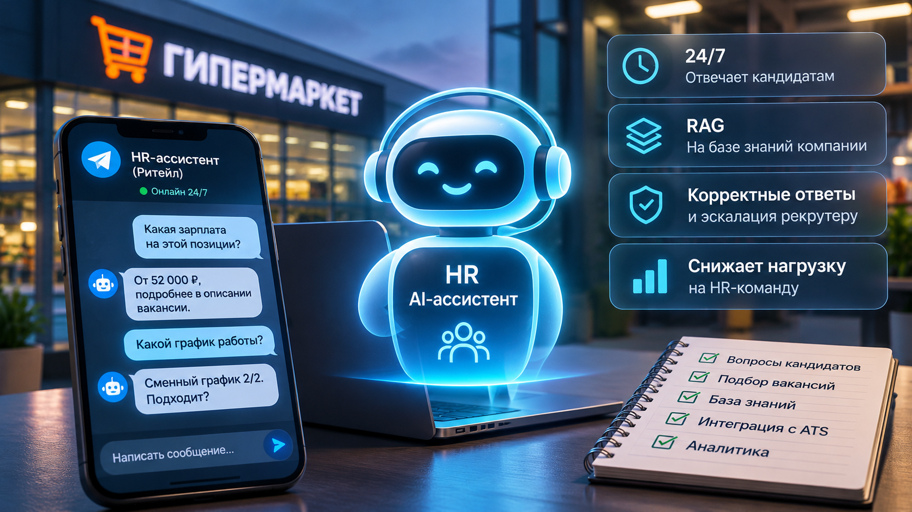
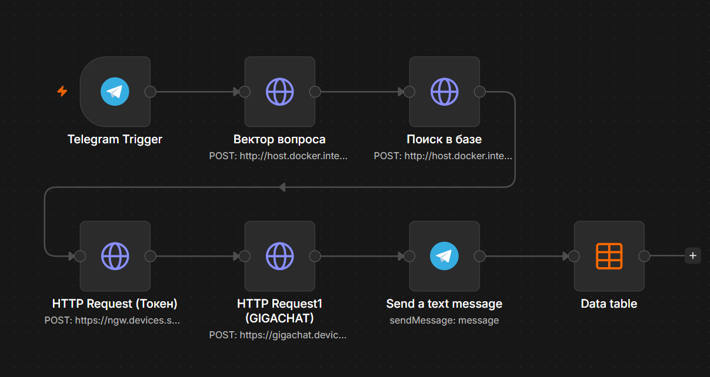
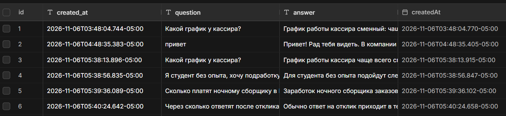
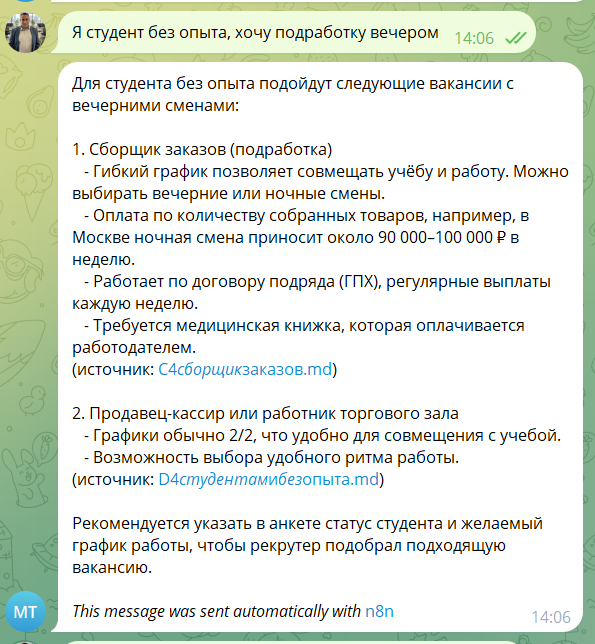

# Как я за 10 дней собрал AI-ассистента для HR. И почему самое сложное в AI-проектах - не AI

**Andrey Semenov**
*Hypermarket Director | Operational Excellence | AI Business Transformation*

Представьте федеральную розничную сеть с десятками гипермаркетов.

Каждый день кандидаты задают одни и те же вопросы:

* «Какая зарплата?»
* «Можно ли работать по сменному графику?»
* «Есть ли вакансии рядом с домом?»
* «Как быстро можно устроиться?»

Часть вопросов поступает вечером и в выходные - именно тогда, когда рекрутеры зачастую уже не работают.

Для кандидата это несколько часов ожидания.

Для бизнеса - риск потерять потенциального сотрудника ещё до первого собеседования.

Я решил проверить, можно ли автоматизировать первую линию общения с кандидатами с помощью AI.

Не на уровне презентации или красивого чат-бота с заготовленными ответами.

А собрать работающий MVP (минимально жизнеспособный продукт), который использует корпоративную базу знаний, подбирает вакансии, обрабатывает нестандартные вопросы и может стать основой для масштабирования.

На эксперимент ушло 10 дней.

И самый неожиданный вывод оказался таким:

**самое сложное в создании AI-системы - далеко не сама нейросеть.**

Это второй эксперимент в моей серии исследований прикладного AI. Первые шаги серии - локальные LLM, мультимодальность, fine-tuning (тонкая настройка моделей) и AI-агенты. Сегодня - бизнес-кейс целиком: от боли кандидата до экономики решения.

## Бизнес-задача: когда масштаб превращает рутину в проблему

Для моделирования я взял сценарий крупной федеральной розничной сети.

Исходные параметры:

* более 90 гипермаркетов;
* средняя численность персонала одного объекта - около 100 человек;
* укомплектованность штата - 70%.

Если принять для расчёта ровно 90 объектов, получаем:

**90 × 100 × 30% = 2 700 незакрытых штатных позиций.**

Это иллюстративная оценка кадрового дефицита, а не подтверждённая статистика конкретной компании. Но она хорошо показывает масштаб задачи.

При таком дефиците рекрутинговая функция постоянно обрабатывает большой поток откликов, обращений и уточняющих вопросов. При этом значительная часть коммуникаций не требует сложного профессионального решения: кандидату нужно объяснить условия работы, график, этапы отбора или доступные вакансии.

Именно здесь я увидел возможность для автоматизации.

Цель MVP - не заменить рекрутёра, а освободить его от повторяющихся консультаций и обеспечить кандидату доступ к информации 24/7.

## Архитектурный выбор: почему я не стал делать обычного чат-бота

Самый простой вариант - подключить LLM (большую языковую модель) к Telegram и написать хороший системный промпт.

Но такая система быстро столкнётся с ограничением.

Откуда модель узнает актуальные вакансии, условия трудоустройства и особенности конкретного работодателя? Можно включить всё в промпт. Но по мере роста объёма информации это становится неудобным, дорогим и сложным в сопровождении.

Поэтому я выбрал архитектуру RAG - Retrieval-Augmented Generation (поиск с генерацией).

Её принцип: модель не должна полагаться только на собственные знания. Перед формированием ответа система ищет релевантную информацию в подготовленной базе знаний.

Для меня это было принципиальным решением. В HR-ассистенте недостоверный ответ - не просто техническая ошибка. Неправильно названная зарплата, график или условие трудоустройства могут создать ложные ожидания у кандидата.

## Как устроен мой MVP

Я сознательно выбрал стек, который можно развернуть и сопровождать самостоятельно, без зависимости от зарубежных AI-провайдеров.

Архитектура:

**Telegram → n8n → RAG-поиск → GigaChat → Ответ кандидату**

Внутри этой цепочки:

* **GigaChat API** - генерация ответов на русском языке.
* **bge-m3 через Ollama** - локальное создание векторных представлений текста.
* **Qdrant** - векторное хранилище для поиска релевантных фрагментов.
* **n8n self-hosted** (собственного размещения) - оркестрация процессов, маршрутизация запросов и взаимодействие между компонентами.
* **Telegram** - пользовательский интерфейс для кандидатов.
* **База знаний** - 18 структурированных документов: описания позиций, FAQ, информация о процессе отбора, подготовленных на основе публичных источников.

Каждый диалог с кандидатом записывается в журнал - время, вопрос, ответ. Для HR это готовая аналитика: какие вопросы задают чаще всего и где базе знаний не хватает информации.

Важное уточнение: Ollama, Qdrant и n8n развёрнуты в собственном окружении, но генерация ответов выполняется через внешний API GigaChat. Это гибридная архитектура, а не полностью изолированная локальная LLM-система.

Моя задача была не собрать максимально сложную архитектуру. А найти разумный баланс между качеством, стоимостью и возможностью самостоятельного сопровождения.

## Первые тесты: что показала работающая система

После сборки я провёл тестирование на 12 сценариях: типовые вопросы кандидатов, уточнения, вопросы вне темы и попытка обойти ограничения.

Результаты тестового прогона:

* качество ответов по базе знаний - **89%**;
* корректность отказов и fallback (запасных сценариев) - **100%**;
* зафиксированные галлюцинации - **0**;
* время ответа - **5-20 секунд**.

Сразу оговорюсь: 12 сценариев недостаточно, чтобы утверждать, что система достигла промышленной надёжности. Показатель 89% отражает оценку качества в рамках проведённого тестирования. Ноль обнаруженных галлюцинаций означает только то, что они не были выявлены в проверенных сценариях.

Тем не менее эксперимент подтвердил, что архитектура способна выполнять основные функции MVP.

Особенно важным для меня оказалось поведение ассистента при недостатке информации. На вопрос «сколько получает директор магазина» система не выдумала цифру - она честно сообщила, что не нашла ответ в базе, и предложила уточнить у рекрутера.

Лучше честно передать вопрос рекрутеру, чем уверенно придумать условия трудоустройства. Это правило я считаю одним из ключевых для корпоративного AI.

## Самое сложное оказалось за пределами LLM

Именно здесь начинается главная часть этого исследования.

Когда мы обсуждаем AI-разработку, внимание обычно сосредоточено на моделях, промптах и качестве генерации.

Но мои десять дней выглядели совсем иначе.

По моей оценке, непосредственно на работу с моделью и промптом ушло около 20% времени. Остальное заняла инженерная инфраструктура: Docker, сетевые соединения, настройка окружения, совместимость версий API, кодировки, запуск и восстановление сервисов.

За время разработки пришлось столкнуться с падениями WSL, остановками сервера эмбеддингов и нестабильностью окружения. В ходе диагностики также была обнаружена вредоносная программа, предположительно влиявшая на работу процессов.

Каждая такая проблема напоминала об одном:

**работающий AI-прототип и надёжная AI-система - разные инженерные задачи.**

Можно за вечер соединить Telegram, n8n и LLM. Но это ещё не означает, что решение выдержит реальную эксплуатацию. Для production (промышленной эксплуатации) нужны мониторинг, восстановление после сбоев, резервное копирование, контроль версий и понятные процедуры запуска.

Именно эти вещи редко попадают в красивые демонстрации AI-продуктов.

## Почему данные и тесты важнее выбора модели

Сначала кажется, что главное - выбрать достаточно интеллектуальную LLM.

Но в RAG-системе качество ответа во многом определяется тем, какую информацию модель получает на вход. Если документы плохо структурированы, содержат противоречия или устарели, даже сильная модель сформирует неправильный ответ. Поэтому я уделил внимание подготовке 18 документов, их структуре и механизму поиска релевантных фрагментов.

Причём работа с данными не заканчивается после создания базы. В реальном HR-процессе вакансии закрываются, зарплатные предложения меняются. Production-архитектура должна включать механизм обновления и контроля актуальности знаний - иначе даже хорошо настроенный RAG со временем начнёт давать устаревшие ответы.

**Качество корпоративного AI начинается с качества корпоративных знаний.**

Вторая часть этой истории - тестирование. Когда проверяешь бота вручную, легко выбрать несколько удачных вопросов и решить, что всё работает. Но стоит подготовить набор разных сценариев - появляются слабые места.

Поэтому я отношусь к тестированию как к отдельному архитектурному компоненту. Не «бот ответил правильно», а систематические проверки: типовой вопрос, нехватка данных, попытка обойти ограничения, передача вопроса человеку, воспроизводимость ошибки.

**Без воспроизводимых тестов мы оцениваем впечатление от AI, а не его надёжность.**

## Экономика: может ли такой ассистент быть выгодным?

Для меня как управленца этот вопрос не менее важен, чем техническая реализация.

При расчётной нагрузке около 4 000 диалогов в месяц предполагаемые расходы на GigaChat API составляют порядка 600 рублей. Ориентировочные ежемесячные затраты на систему, включая инфраструктуру, - 1 200-6 400 рублей в зависимости от сценария размещения и эксплуатации.

Если ассистент будет самостоятельно обрабатывать не менее 60% типовых обращений, расчётное высвобождение времени рекрутеров может составить 110-150 часов в месяц. При условной стоимости часа 600 рублей это эквивалентно 66-90 тысячам рублей рабочего времени в месяц.

Важно: это не фактически полученная экономия и не гарантированное сокращение фонда оплаты труда. Это потенциальная высвобожденная ёмкость HR-команды, которую можно направить на собеседования, работу с кандидатами и закрытие вакансий.

Предварительная модель предполагает окупаемость разработки за 2-4 месяца, но подтвердить её можно только после пилота с реальным потоком обращений.

Главный вопрос здесь даже не в стоимости токенов.

**Сколько полезного рабочего времени мы возвращаем бизнесу?**

## Демонстрация тоже требует архитектуры

За эти десять дней я понял и вот что: демонстрация работающего AI-продукта - отдельная инженерная задача.

Даже если система исправно работала вчера, сегодня может не запуститься Docker, остановиться сервис эмбеддингов или возникнуть проблема с сетью.

Поэтому у меня два практических правила: чек-лист холодного запуска всей системы и резервная запись демонстрации - как страховка на случай инфраструктурного сбоя. Профессиональная демонстрация должна зависеть от качества решения, а не от удачного стечения технических обстоятельств.

## Что дальше: от MVP к корпоративному HR-ассистенту

Для реального внедрения одного MVP недостаточно. Следующий этап - четыре направления.

**Первое - пользовательский интерфейс.** Перенести ассистента на карьерный сайт, чтобы кандидат получал ответ в процессе выбора вакансии.

**Второе - интеграция с ATS** (Applicant Tracking System - системой отслеживания кандидатов). Актуальные вакансии и статусы откликов через разрешённые интерфейсы - ассистент перестанет зависеть от статичной базы знаний.

**Третье - оптимизация стоимости.** Кеширование, управление контекстом, измерение расхода токенов и стоимости каждого обращения.

**Четвёртое - наблюдаемость.** Развитие журнала в аналитику: метрики качества, статистика вопросов, обнаружение ошибок.

Отдельной задачей станет безопасность: разграничение доступа, минимизация персональных данных, проверка требований к их обработке и хранению.

Именно после этого можно обсуждать пилот в реальном HR-процессе.

## Главный урок

Этот проект объединил несколько направлений моих исследований в одной прикладной бизнес-задаче: кадровый процесс, подготовка знаний, архитектура взаимодействия компонентов, доступность инфраструктуры, качество ответов, экономика - и граница, где заканчивается ответственность AI и начинается ответственность человека.

Сложность корпоративного AI определяется не только интеллектом модели, а качеством всей системы вокруг неё.

LLM - лишь один компонент. Реальная архитектура начинается там, где появляются данные, интеграции, ограничения, безопасность, наблюдаемость и ответственность за результат.

Создать AI-бота можно быстро. Создать AI-систему, которой бизнес сможет доверить реальный процесс, - совсем другая задача.

---

**Что, на ваш взгляд, сегодня сильнее тормозит внедрение AI в бизнес - возможности моделей или сложность интеграции с реальными процессами?**

Буду рад обсудить практический опыт - особенно в ритейле, HR и корпоративной автоматизации.

*Исследование выполнено на MVP с демонстрационной базой знаний. Приведённые метрики получены в ограниченном тестировании. Экономические показатели являются расчётными сценариями, а не подтверждёнными результатами промышленного внедрения.*
