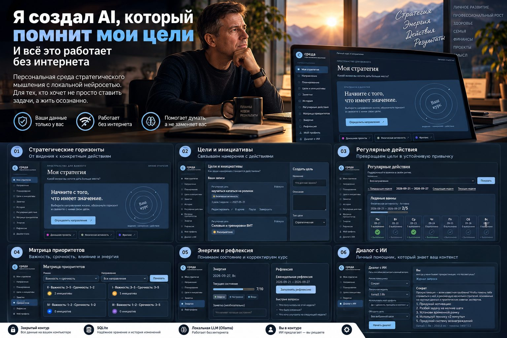
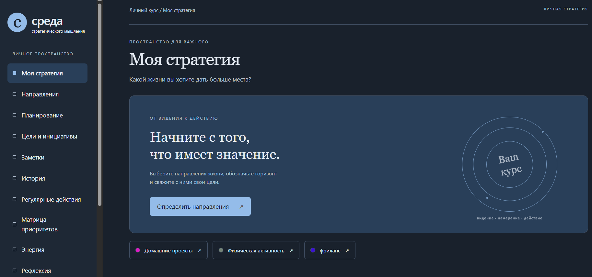
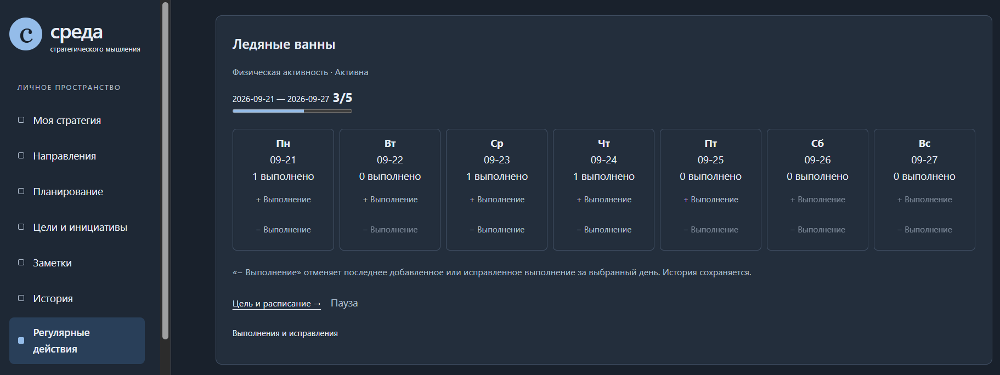
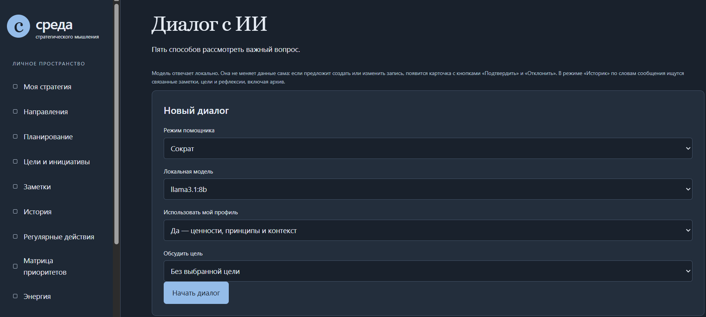

Ещё недавно это звучало почти как фантастика. Сегодня я создаю персональную среду стратегического мышления с локальной нейросетью, собственным планировщиком и полным контролем над данными.

Представьте обычное утро.

Вы открываете приложение, а оно встречает вас не очередным списком из двадцати задач.

Вместо этого персональный AI-помощник говорит:

> «Андрей, доброе утро!
>
> На этой неделе ты планировал пять ледяных ванн, три тренировки и два занятия по AI-архитектуре.
>
> Три ледяные ванны уже выполнены. Хорошее начало!
>
> А вот работу над AI-проектом ты переносил дважды. В последней рефлексии ты отметил, что к вечеру у тебя остаётся мало энергии для сложных задач.
>
> Может быть, сегодня стоит выделить час утром на проект?
>
> Кстати, как продвигается твоя работа? Что сейчас мешает двигаться быстрее?»

И это не стандартная мотивирующая фраза, которую нейросеть выдаёт всем подряд.

Это рекомендация, основанная на ваших целях, истории выполнения, личных заметках и предыдущих размышлениях.

Система помнит, куда вы хотите прийти.

Видит, что вы для этого делаете.

Помогает замечать отклонения.

И возвращает внимание к тому, что действительно важно.

А теперь самое интересное: всё это может работать на вашем собственном компьютере. Без облачной нейросети, внешних AI API и передачи личных записей третьим сторонам.

Ещё несколько лет назад для меня это выглядело бы как фантастика.

Сегодня я создаю именно такой инструмент.

Я назвал его **«Среда стратегического мышления»**.

И хочу рассказать, почему вообще решил его разработать, что уже получилось и как здесь связан мой многолетний опыт операционного управления с AI-архитектурой.

## Почему мне понадобился собственный планировщик

За 25 лет операционного управления я привык работать с целями, показателями, планами, ресурсами и результатами.

В бизнесе мы постоянно задаём вопросы:

* Куда движемся?
* Какой результат хотим получить?
* Какие действия для этого необходимы?
* Что мешает?
* Какие ресурсы потребуются?
* Что нужно изменить, если план не выполняется?

Но однажды я задумался: почему мы так тщательно проектируем системы управления бизнесом и гораздо реже создаём столь же последовательные системы управления собственным развитием?

Обычный таск-менеджер помогает не забыть о задаче.

Календарь помогает выделить время.

Трекер привычек показывает регулярность.

Заметки сохраняют идеи.

Но всё это часто существует отдельно друг от друга.

А мне хотелось видеть всю картину.

Не просто «что сделать сегодня», а как сегодняшние действия связаны с моими целями на год, стратегией и более долгосрочным видением.

Так появилась идея объединить всё в одной системе.

И добавить к ней персонального AI-помощника.

## От видения на годы - к конкретному действию сегодня

Первое, что я хотел получить, - полноценную систему стратегического планирования.

Не список задач.

А пространство, в котором можно последовательно пройти путь:

> **Видение → Стратегия → Цель → Регулярное действие → Результат → Рефлексия.**

В приложении появились несколько горизонтов планирования: долгосрочное видение, стратегия, год, квартал, месяц и неделя.

Есть и отдельный горизонт «Когда-нибудь» - для идей, которые пока не требуют немедленного исполнения.

Например, я ставлю цель развивать компетенции в AI-архитектуре.

Это не просто одна запись в списке.

У цели появляются конкретные инициативы, ожидаемые результаты и регулярные действия.

Допустим, я решаю заниматься изучением AI три раза в неделю.

Система включает это действие в недельный трекер согласно расписанию.

Я отмечаю выполнение, вижу прогресс, могу изменить периодичность и при этом сохранить историю предыдущих планов.

То же самое касается спорта, работы над собственными проектами и других направлений жизни.

Стратегия перестаёт быть документом, который написал в январе и забыл к марту.

Она постепенно превращается в систему ежедневных действий.

## Мой любимый пример - ледяные ванны

В моём приложении есть реальная регулярная цель: ледяные ванны пять раз в неделю.

В недельном трекере видно:

* План - 5.
* Выполнено - 3.
* Прогресс - 3/5.

Каждый день представлен отдельной карточкой, где можно отметить выполнение.

Казалось бы, обычный трекер привычек.

Но для меня здесь важна связь с более длинной историей.

Это действие относится к направлению «Физическая активность».

У него есть собственная периодичность.

История выполнения.

Возможность изменить расписание.

И в дальнейшем - возможность обсудить результат с AI.

Например:

> «Андрей, на этой неделе ты выполнил две из пяти запланированных ледяных ванн. Хочешь сохранить первоначальную цель или пересмотреть расписание?»

Или:

> «В последние несколько недель ты стабильно выполняешь три тренировки, но с ледяными ваннами регулярность ниже. Давай посмотрим, что мешает».

Вот здесь обычный трекер начинает превращаться в инструмент рефлексии.

## Управлять нужно не только временем, но и энергией

Есть ещё одна идея, которую я хотел обязательно заложить в продукт.

Мы привыкли планировать время.

Но далеко не всегда учитываем, что час утром и час поздно вечером - это совершенно разные ресурсы.

Можно поставить сложную интеллектуальную задачу на 21:00, а потом несколько дней подряд переносить её и обвинять себя в недостаточной дисциплине.

Хотя проблема может быть не в дисциплине.

Возможно, для этой задачи просто выбран неподходящий период.

Поэтому в приложении появились оценка энергии, временные контейнеры и несколько моделей приоритизации.

В том числе классическая матрица Эйзенхауэра:

> **Важность × Срочность.**

А также:

* **Влияние × Усилие.**
* **Важность × Энергия.**

Для меня это принципиальный момент.

В операционном управлении мы постоянно оцениваем ресурсы компании.

Но собственную энергию нередко воспринимаем как нечто бесконечное.

А она такой не является.

И я хочу, чтобы моя система планирования это учитывала.

## А теперь представьте, что вся эта информация становится контекстом для AI

Вот здесь проект перестаёт быть обычным приложением для планирования.

Потому что локальная языковая модель может работать не с одним изолированным запросом, а с контекстом, который накапливается в системе.

Мои стратегические цели.

Планы на год и квартал.

Регулярные действия.

История выполнения.

Личные заметки.

Рефлексии.

Оценки энергии.

Ценности и принципы.

Всё это не просто отдельные записи.

Это информация, которая помогает понять, почему я ставлю определённые цели, как двигаюсь к ним и что меняется со временем.

И когда эти данные становятся доступным контекстом для AI, появляются совершенно другие возможности.

Например, я могу спросить:

> «Почему я постоянно откладываю работу над своим проектом?»

И получить не только стандартные советы о борьбе с прокрастинацией, а разбор с учётом моих собственных записей.

В идеале помощник сможет заметить:

> «В последней рефлексии ты писал, что слишком много времени уходит на параллельные инициативы. Возможно, дело не в прокрастинации, а в конфликте приоритетов?»

Или:

> «Ты уже несколько недель планируешь заниматься AI-архитектурой по вечерам, но регулярно отмечаешь низкий уровень энергии в это время. Может быть, стоит изменить расписание?»

Вот ради такого взаимодействия я и начал создавать эту среду.

Не ради красивого AI-чата.

А ради помощника, который способен поддерживать непрерывность стратегического мышления.

## AI, который не ждёт, пока ты вспомнишь о своих целях

Обычно взаимодействие с нейросетью выглядит так:

Вы открываете чат.

Формулируете запрос.

Объясняете контекст.

Получаете ответ.

В следующий раз многое приходится объяснять заново.

Я хочу другого пользовательского опыта.

Открываешь приложение - и помощник сам помогает вернуться к текущему контексту.

Он может предложить обсудить вчерашний результат, обратить внимание на невыполненное регулярное действие, напомнить о стратегической цели или задать вопрос для рефлексии.

Например:

> «Ты завершил важный этап проекта, над которым работал несколько недель. Давай зафиксируем результат и определим следующий шаг».

Или:

> «В прошлой месячной рефлексии ты решил сократить количество параллельных проектов. Сейчас у тебя появилось ещё три новых инициативы. Какие из них действительно соответствуют твоей стратегии?»

Или просто:

> «Ты поставил цель заниматься спортом три раза в неделю. Пока выполнена одна тренировка. В какие дни тебе будет удобнее провести оставшиеся две?»

Это не попытка создать цифрового начальника.

И не система, которая должна постоянно оценивать человека.

Наоборот.

Это способ поддерживать осознанность в условиях, когда ежедневная рутина постоянно конкурирует со стратегическими целями.

Именно инициативное сопровождение при открытии приложения я рассматриваю как один из следующих важных этапов развития продукта.

## Что уже работает: локальный AI-диалог

Сейчас в приложении реализован отдельный раздел «Диалог с ИИ».

И это уже не концепция на бумаге.

На моём компьютере работает локальная языковая модель **llama3.1:8b через Ollama**.

В интерфейсе предусмотрены пять режимов помощника, выбор модели, использование личного профиля и возможность обсуждать конкретную цель.

Можно включить личный профиль - ценности, принципы и контекст.

Можно выбрать цель, которую хочешь обсудить.

Можно работать с историей связанных записей.

При этом интерфейс показывает, какой контекст передавался модели, а журнал запроса помогает разбирать работу AI.

Я уже тестирую различные режимы диалога.

Например, в режиме «Сократ» помощник помогает рассматривать проблему через вопросы.

В режиме «Критик» - предлагает взглянуть на ситуацию с другой стороны.

На одном из тестов я спросил:

> «Иногда у меня бывает прокрастинация. Что посоветуешь?»

Локальная модель предложила несколько способов: разбить большую задачу на небольшие шаги, установить временные рамки, вспомнить мотивацию и использовать короткие действия для начала работы.

Пока это преимущественно общие рекомендации.

И именно здесь находится следующий важный этап разработки - сделать ответы более персональными за счёт корректного использования накопленного контекста.

Но уже сейчас меня радует сам факт:

**AI работает локально. На моём компьютере. Без обращения к облачной нейросети.**

## Почему закрытый контур был для меня принципиальным решением

Когда я начал проектировать приложение, у меня было ещё одно требование.

Я не хотел передавать личные планы, размышления и стратегические решения внешним AI-сервисам.

Такая информация может быть достаточно чувствительной.

Причём речь не обязательно о коммерческой тайне.

Иногда личные цели, сомнения, оценки собственного состояния и записи о важных решениях - это именно та информация, которую человек хочет оставить только у себя.

Поэтому я выбрал локальную архитектуру.

* Приложение работает на **Python и FastAPI**.
* Основные данные хранятся в **SQLite**.
* Локальная языковая модель запускается через **Ollama**.
* Сервер доступен только через `127.0.0.1`.
* Для основного рабочего сценария не нужны внешние AI API.

После установки необходимых компонентов и загрузки модели приложение может работать без интернета.

Для меня это не просто техническая особенность.

Это возможность использовать AI в пространстве, где я контролирую хранение информации.

Конечно, локальное размещение само по себе не гарантирует абсолютную безопасность. Компьютер необходимо защищать, а данные - резервировать.

Но зависимость от внешней инфраструктуры становится значительно меньше.

И мне нравится сама идея:

**Персональный AI может быть действительно персональным не только по содержанию ответов, но и по архитектуре.**

## Самое важное: AI не управляет моей жизнью

В процессе разработки я принял решение, которое считаю одним из главных для всего проекта.

AI не должен самостоятельно менять мои цели, планы и записи.

Он может анализировать доступный контекст.

Предлагать действия.

Помогать структурировать мысли.

Формулировать рекомендации.

Но если предложение предполагает изменение данных, решение остаётся за мной.

Для этого предусмотрен отдельный механизм подтверждения.

Например, модель предлагает:

> «Разбить инициативу на три регулярных действия».

Под сообщением появляется карточка с описанием предлагаемого изменения.

Я могу подтвердить или отклонить его.

При подтверждении приложение повторно проверяет данные и только затем применяет изменение.

При отклонении основные данные остаются прежними.

В AI-архитектуре этот принцип называется **Human-in-the-loop**.

Для меня его смысл очень простой:

**AI может помогать мне думать, но не должен принимать за меня жизненные решения.**

И чем больше я работаю с AI, тем сильнее убеждаюсь, что не всякую доступную автоматизацию нужно реализовывать.

Иногда ценность технологии заключается не в том, чтобы исключить человека из процесса.

А в том, чтобы дать ему больше возможностей для осознанного выбора.

## За красивым интерфейсом оказалась серьёзная инженерная работа

Когда я только задумывал этот проект, мне казалось, что самая сложная часть - связать стратегическое планирование с локальной нейросетью.

На практике значительная часть работы оказалась связана с архитектурой данных и надёжностью операций.

Сегодня в приложении реализована предметная модель с 22 таблицами, миграциями базы данных, журналом событий и очередью event_outbox.

Изменения записываются в историю.

Повторные запросы с одинаковым идентификатором не должны создавать дубли.

При конфликте версий приложение не перезаписывает молча более свежие данные.

Для AI-предложений предусмотрены повторная валидация и транзакционное применение изменений.

Есть автоматизированные тесты и E2E-проверки в Chrome.

Зачем всё это персональному планировщику?

Потому что я хочу пользоваться им регулярно.

И не хочу однажды обнаружить, что история выполнения изменилась, цель продублировалась или AI записал действие, которое я не подтверждал.

Даже персональный AI-продукт должен быть спроектирован как система, которой можно доверять.

Это ещё один вывод, к которому я пришёл за время работы над AI-проектами.

## Что дальше

Сейчас у приложения уже есть основа, на которой можно развивать персонального стратегического помощника.

Следующие направления - смысловой поиск RAG по записям и рефлексиям, расширение AI-инструментов, автоматизированное резервное копирование и восстановление, проверки доступности и производительности.

Но самое интересное для меня - дальнейший переход от обычного AI-диалога к более инициативному помощнику.

Который способен при открытии приложения формировать персональную повестку на основе актуального контекста.

Не просто отвечать на вопросы.

А помогать поддерживать движение к выбранным целям.

При этом я не хочу превращать систему в ещё один источник уведомлений и давления.

Хороший помощник должен уметь не только напоминать о делах, но и помогать понять, когда необходимо пересмотреть план, снизить нагрузку или признать, что приоритеты изменились.

## И вот что я понял как управленец

Этот проект оказался для меня гораздо большим, чем эксперимент с локальной языковой моделью.

Он позволил объединить две профессиональные области, которыми я занимаюсь.

С одной стороны - многолетний опыт операционного управления: цели, процессы, показатели, ресурсы, контроль и развитие людей.

С другой - AI-архитектура: модели, данные, автоматизация, ограничения, наблюдаемость и управление действиями AI.

И в какой-то момент я понял, что применяю к собственной жизни тот же принцип, который использовал в управлении бизнесом.

Не просто ставить задачи. Строить систему, которая помогает достигать целей.

Только теперь у этой системы появляется персональный AI-помощник.

Он не знает будущего.

Не обладает собственной мудростью.

Не способен гарантировать правильность решений.

Но он может помогать видеть связи, которые теряются в ежедневной рутине.

Возвращать внимание к долгосрочным целям.

Напоминать о собственных решениях.

Помогать анализировать результаты.

И предлагать следующий шаг.

Для меня это и есть наиболее интересное направление развития персонального AI.

## Вместо вывода

Я создавал «Среду стратегического мышления» для себя.

Не как очередной SaaS.

Не как универсальный таск-менеджер.

И не ради того, чтобы продемонстрировать, что локальная нейросеть умеет поддерживать диалог.

Мне хотелось создать пространство, в котором можно думать о будущем, видеть связь между стратегией и ежедневными действиями, учитывать собственную энергию и получать персональную поддержку AI.

При этом сохранять контроль над данными и решениями.

И знаете, что мне нравится в этом проекте больше всего?

Ещё недавно сама идея выглядела почти фантастикой:

**Персональный AI, который работает на твоём компьютере, помнит контекст твоих целей и помогает тебе двигаться к ним.**

Сегодня это уже не вопрос принципиальной возможности.

Это вопрос архитектуры, качества данных и того, насколько хорошо мы понимаем, какую роль хотим отдать искусственному интеллекту.

А мой главный принцип остался прежним:

**Не AI должен управлять человеком. AI должен помогать человеку лучше управлять собственной жизнью.**

Именно такую систему я и создаю.

---

**А вы доверили бы локальному AI свои стратегические цели, планы и личные рефлексии, если бы все данные оставались только на вашем компьютере?**

---

*Автор: Андрей Семенов*
*Направление: Operational Excellence × Strategic Planning × AI Architecture*
*Проект: «Среда стратегического мышления»*
*Технологии: Python · FastAPI · SQLite · Ollama · Llama 3.1 8B*
