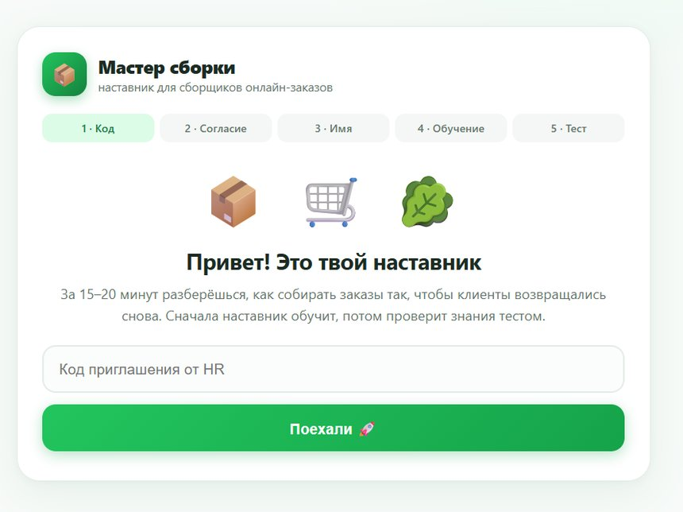
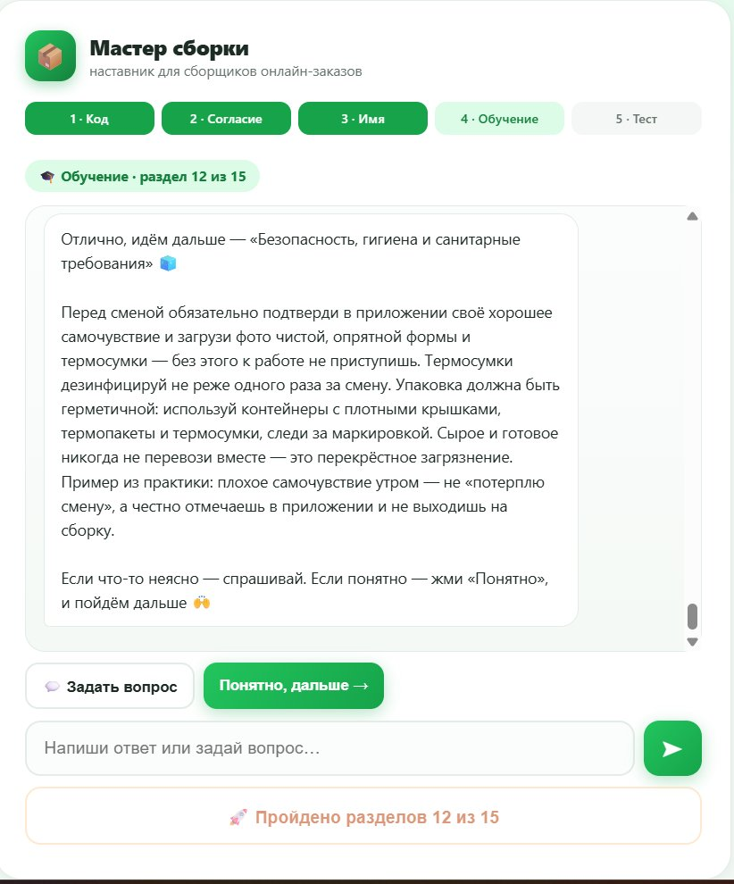
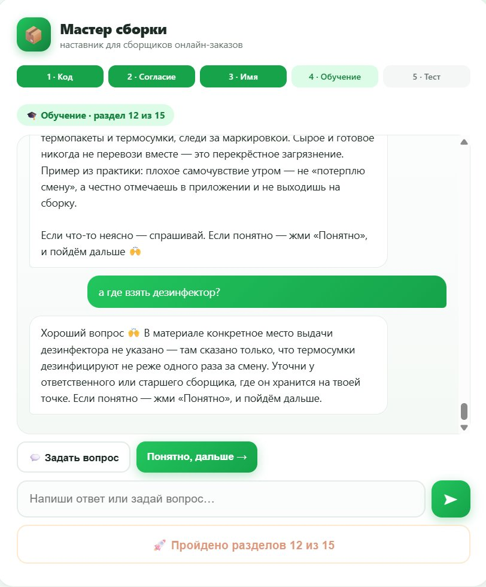
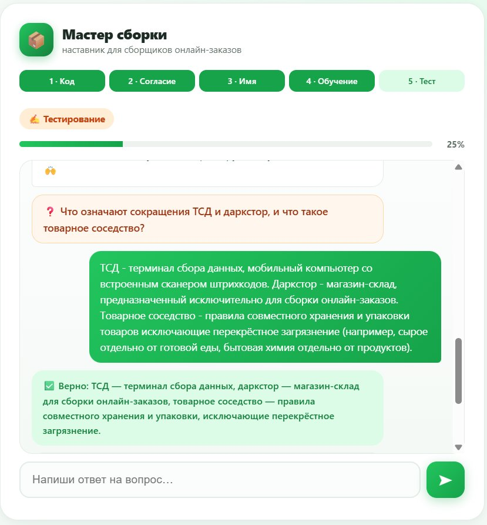
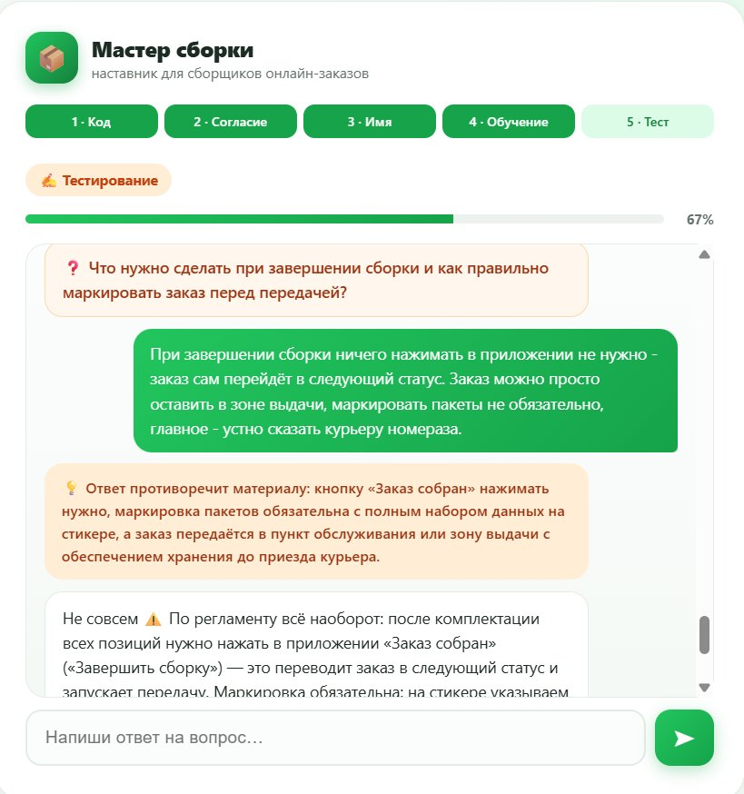
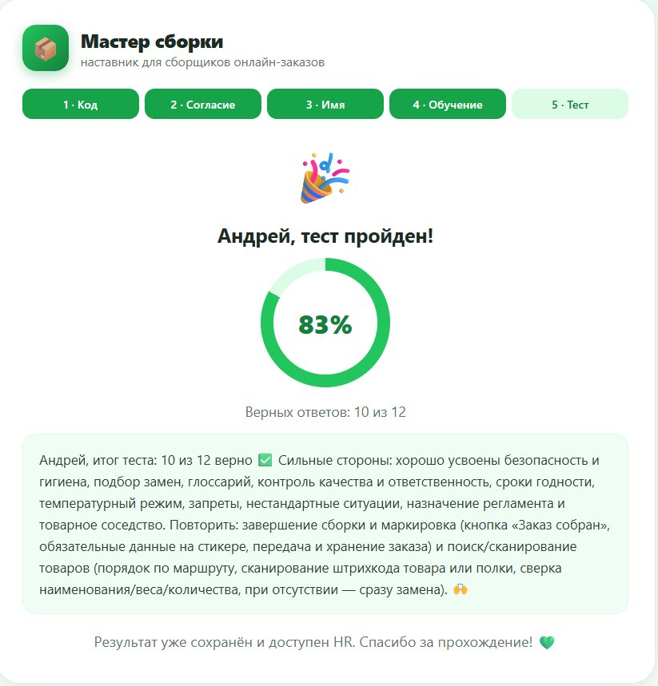
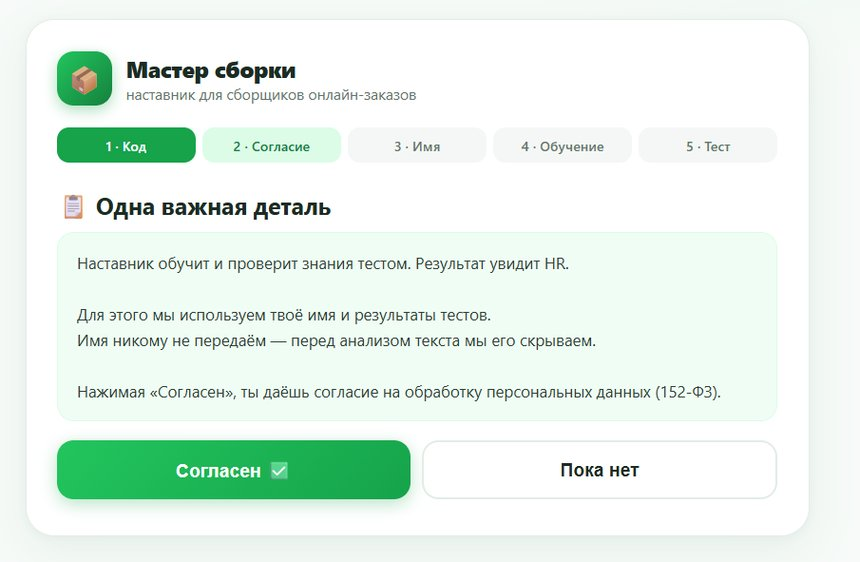

# Новичок вышел на смену. Кто его научит?

**Andrey Semenov**
*Hypermarket Director | Operational Excellence | AI Business Transformation*

Одна из самых дорогих болей, которую я наблюдаю изо дня в день, - это служба доставки.

Ротация там огромная: сборщик отработал два-три месяца и ушёл. На его место выходит новый человек, и цикл начинается заново. При этом качество плавает: перепутанные товары в заказе, заморозка, которая «погостила» вне холодильника, бытовая химия в одном пакете с продуктами. Каждая такая ошибка - это возврат, недовольный клиент, штрафы агрегаторов и удар по репутации магазина.

Я долго разбирался, где именно теряется качество. Регламент есть, подробный, на десятки страниц. Наставники есть. Но вот как это выглядит на практике: человек вышел на смену, его посадили за терминал, коллега за двадцать минут «показал основное», и он уже собирает заказы реальных покупателей. Формальное тестирование знаний существует на бумаге, но его легко пропустить: начальник смены занят, новичок стесняется спрашивать, всем «вроде понятно». Самый важный этап просто растворяется.

Вывод неприятный: проблема не в людях. Проблема в том, что обучение в критический момент зависит от дисциплины и свободного времени конкретного человека.

Внедрение таких решений в моей компании не входит в мою компетенцию (часть доставки вообще работает через партнёров). Но раз процесс я вижу изнутри, а инструменты мне знакомы, я сделал такого помощника самостоятельно, как независимый проект.

## Что из этого вышло

Это AI-наставник: система, которая обучает и тестирует каждого нового сотрудника лично и пошагово. Не взамен наставника-человека, а как гарантия того, что обучение случится в любом случае.

Начало обучения - обычный чат: сотрудник открывает Telegram или браузер и входит по одноразовому коду от HR. Ничего устанавливать не нужно.

С регламентом он знакомит простыми словами, как опытный коллега на смене, а не как инструкция на пятьдесят страниц. Материал разбит на разделы в порядке бизнес-процесса - от начала смены до передачи заказа. Система ведёт по ним по очереди: объяснил блок простыми словами, ответил на вопросы, кнопка «Понятно», следующий блок. Пропустить раздел нельзя, темп выбирает сотрудник, прогресс виден: «раздел 7 из 15».

И главное: обучение идёт как диалог, а не как чтение лекции. Сотрудник задаёт вопрос в любой момент - хоть по ходу раздела, хоть между ними: «а где взять дезинфектор?» Это не экзамен, спрашивать не стыдно. Наставник отвечает по материалу, а если ответа в регламенте нет - не выдумывает, а честно говорит об этом и подсказывает, у кого уточнить. Именно этим он отличается от обычного чат-бота, который в такой ситуации «дофантазирует» правила сборки.

Контроль знаний - только после обучения: итоговый тест по всем темам. После полного прохода начинается тест: 12 вопросов, для каждого система случайно выбирает разделы из 15 - у каждого сотрудника свой набор тем, поэтому «сфотографировать вопросы и передать другу» почти бесполезно.

Оценивает ответы по смыслу, а не по дословному совпадению: «заморозку в термопакет, не более 20 минут» и «положить холодное в термоконтейнер на двадцать минут» - это один и тот же верный ответ, просто разными словами. А если сотрудник отвечает неверно, наставник показывает, какой пункт материала был нарушен.

И показывает, где ошибаются чаще всего. Каждый проверенный ответ привязан к разделу регламента. Руководство видит не «все прошли курс на пятёрку», а конкретику: вот вопрос, на который отвечают неверно в 70% случаев. Значит, этот раздел надо переписать или разобрать на планёрке.

## Почему не «просто усилить контроль наставников»

Потому что человеческий фактор приказом не отменяется. Наставник устал, заболел, уволился, сам недавно новичок. И система обучения молча разваливается ровно до следующей проверки качества.

Программа не устаёт, не стесняется переспросить и одинаково вежлива в девять утра и в одиннадцать вечера. В высокий сезон, в новогодние праздники или распродажи, когда новичков максимум, а времени у руководителей минимум, это становится решающим.

## Как это устроено

Для сотрудника всё выглядит как обычный чат - показано на скриншотах выше. Дальше диалог: согласие на обработку персональных данных, имя, обучение по шагам, тест, итог.

Внутри три вещи, о которых стоит знать.

**Первая - база знаний.** В систему загружается регламент компании, и ответы наставник даёт только на его основе, находя нужный раздел по смыслу и по ключевым словам одновременно.

**Вторая - контролёр качества.** Отдельный ИИ-«судья» перепроверяет оценки наставника: мягкий не должен поддакивать, строгий не должен занижать. При расхождении вердикт судьи в приоритете.

**Третья - защита персональных данных по 152-ФЗ.** Перед отправкой текста во внешнюю языковую модель имена, телефоны и почта заменяются заглушками, обратная подстановка происходит локально. Сотрудник может выгрузить свои данные или потребовать их удаления, обе процедуры предусмотрены и фиксируются в журнале. Плюс модерация общения: грубости не уходят в ИИ и не доходят до ответа, инциденты записываются в журнал - HR видит картину.

Для компаний с жёсткими требованиями к данным есть вариант развернуть всё целиком внутри контура компании: локальная модель, локальная база, ни один байт наружу. С установкой справится системный администратор по инструкции, примерно за полчаса.

## Что дальше: ищу пилотную площадку

Система собрана, протестирована и готова к пилоту. Идеальный сценарий: служба доставки магазина или даркстор с текучкой сборщиков. Две-три недели, ваш регламент, группа новых сотрудников. На пилоте измерим время выхода на самостоятельную сборку, долю ошибок и разгрузку наставников.

Дальше в планах интеграция с кадровой системой (обучение стартует автоматически при оформлении сотрудника), дашборд для руководителей смены и расширение с доставки на кассы и приёмку товара.

Если тема откликается - напишите мне. Покажу демо и расскажу подробнее.

## Итог

Мы привыкли требовать качества у людей, но забываем проверить, дали ли мы им для этого инструмент. Обучение нельзя строить на надежде, что наставник найдёт минутку. AI-наставник не заменяет живого, он гарантирует, что обучение и проверка знаний произойдут всегда: в пик сезона, при текучке, даже когда наставник ушёл в отпуск.

Качество сборки начинается не с контроля ошибок. Оно начинается с того, что новый сотрудник в первый же день понимает, зачем заморозке нужен термопакет.

А как у вас обучают новичков в первую неделю? Что срабатывает, а что рассыпается?

Буду рад обменяться опытом в комментариях или в личных сообщениях. Мои проекты: [semenov-ai.ru](https://semenov-ai.ru/)

## Приложение (для технарей)

Стек: Python, FastAPI, aiogram (Telegram и веб-канал на одном ядре). Поиск по базе знаний - гибридный: pgvector + полнотекстовый поиск PostgreSQL со склейкой рангов, эмбеддинги считаются локально. Обезличивание персональных данных перед отправкой во внешний LLM (DeepSeek через OpenAI-совместимый API, можно подключить любой, включая локальный). Ход обучения детерминирован: переход между разделами ведёт код (кнопка «Понятно»), полный проход обязателен, тест открывается только после него - языковая модель отвечает за контент, а не за протокол. Миграции на Alembic. 57 автотестов pytest, включая сквозной сценарий «вход, согласие, обучение, тест, результат». CI на GitHub Actions: ruff, mypy, pytest. Docker Compose, есть вариант on-prem с Ollama.

Код: [github.com/semandr72-eng/onboard](https://github.com/semandr72-eng/onboard)
